# ShadowRealm-OS

A Debian 13 desktop with its own look, built around Xfce and a set of small, integrated desktop tools.

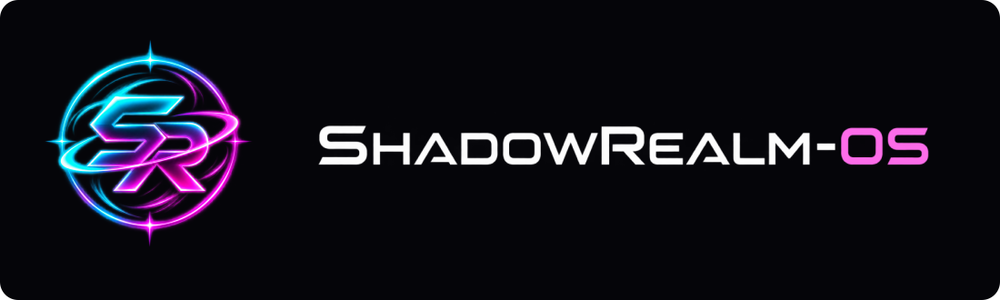

**2026.11 beta 1 | AMD64 | live desktop and installer**

ShadowRealm-OS keeps the familiar Linux desktop: applications, files, a terminal and a package manager. Its custom panel, dock, widgets and Control Center bring the everyday controls together. Eight coordinated styles range from Neon and Hacker to White, Silver & Gold and a quieter Professional theme. Wallpapers can be changed separately.

> **Website updates in progress:** We are reorganizing the project pages and refreshing screenshots. Screenshots show the current desktop updates. The current beta download is unchanged.

## Download and install

[Download the beta ISO](https://sourceforge.net/projects/shadowrealm-os/files/2026.11-beta1/ShadowRealm-OS-2026.11-beta1-r4-amd64.iso/download) | [Checksums](https://sourceforge.net/projects/shadowrealm-os/files/2026.11-beta1/SHA256SUMS/download) | [Licenses & source-download guide](https://sourceforge.net/projects/shadowrealm-os/files/2026.11-beta1/)

Check the ISO against `SHA256SUMS` before writing it to a USB drive or attaching it to a virtual machine.

The AMD64 ISO starts a live desktop so you can try it before installing. Open **Install ShadowRealm-OS** to install to a disk. The installer supports BIOS and UEFI systems and offers disk encryption. Back up your files first; choosing to erase a disk deletes its contents.

- [Install on a PC or in VirtualBox](docs/installation.md)
- [System requirements and test limits](docs/system-requirements.md)
- [Desktop, software and updates](docs/user-guide.md)
- [Build from source](docs/build-guide.md)

## Included

- Custom application menu with categories, favorites and adjustable sizing; editable dock and desktop shortcuts.
- Coordinated GTK, window, icon, terminal, login and boot artwork using the SR identity.
- Control Center for appearance, accounts, network, audio, Bluetooth and system tools. Hardware controls depend on the available device and driver.
- Debian APT packages, the signed LibreWolf repository, and Flatpak support.
- LibreWolf, Thunderbird, LibreOffice, VLC, Thunar, Mousepad and other desktop applications. See the release package inventory for exact versions.
- Shadow Shield controls for the firewall and privacy tools, plus AppArmor policies. These tools do not make a system anonymous or immune to attacks.
- Drawing for simple painting; GNOME Clocks for alarms, timers, world clocks and stopwatch.
- Customizable login backgrounds, optional original session chimes and three screensaver animations with standard XFCE locking.
- Nine offline games, including Shadow Pinball, Skull Invaders, Shadow Runner, Circuit Chase, Snake, Shadow Spider Solitaire, Neon Ascent, Neon Breaker and Marble Reactor. Scores and settings stay local.

**Desktop 0.2.17, artwork 0.2.5 and Terminal 0.2.3** add independent icon/dock selection in Appearance, consistent dock families, corrected panel symbols, and improved widget and Terminal controls. Weather, Local Search and the DNSCrypt transition fix are included in the signed update stream. Install updates through Software & Updates. [Release notes](CHANGELOG.md)

## Screenshots

### Terminal

A familiar shell with live system information, adjustable text and desktop-matched colors.

### Control Center

Network, audio, Bluetooth, accounts, appearance and software tools in one place.

### Widgets and system tools

Eight independent widgets, shown together in Professional styling. They follow your desktop theme and can be moved, resized and customized separately.

| System overview | Network | Processes | Shadow Shield |
| --- | --- | --- | --- |
| 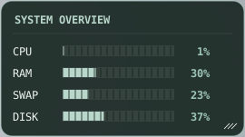 | 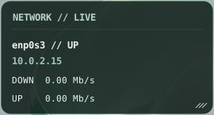 | 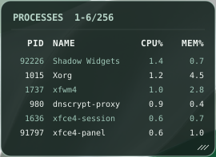 | 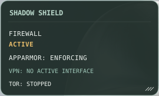 |
| CPU, memory, swap and system disk usage. | Active interface, address and live transfer rates in Mb/s. | Process names, PIDs, CPU and memory usage. | Firewall, AppArmor, Tor and VPN service status. |

| Clock | Calendar | Notes | Weather |
| --- | --- | --- | --- |
| 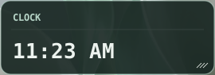 | 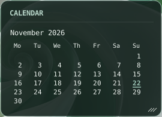 | 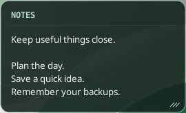 | 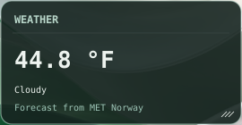 |
| An independent, easy-to-read local clock. | Month view with today's date highlighted. | A small place to keep local notes and reminders. | An optional forecast for a manually chosen location. |

Arrange and customize your widgets

Choose which panels appear, adjust their text, graph and bar colors, and set background transparency. Theme follows the shared background setting in Appearance.

[Desktop widgets guide](docs/widgets.md)

View full-size panels: [Network](screenshots/system-tools/network.png), [Shadow Shield](screenshots/system-tools/shield.png), [Software & Updates](screenshots/system-tools/software-updates.png).

### Applications

Search and browse installed applications by category. The dock keeps the shortcuts you choose.

### Games

Nine lightweight arcade and card games, with local scores and settings. No accounts or advertisements.

[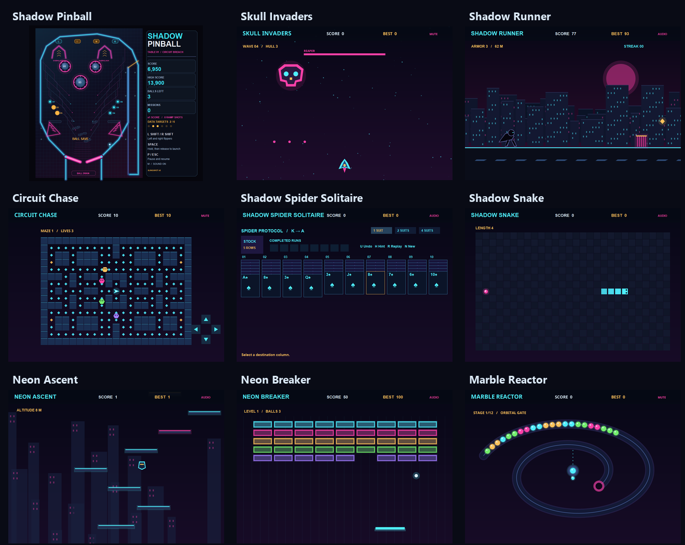](https://astrashadowsss.github.io/ShadowRealm-OS/#games)

[Browse individual game screenshots](https://astrashadowsss.github.io/ShadowRealm-OS/#games).

### Wallpapers and themes

[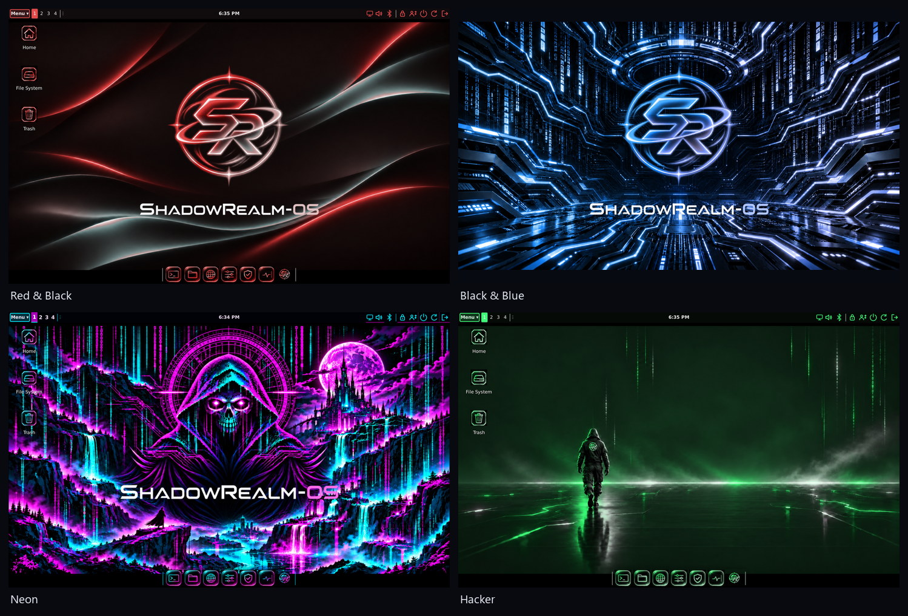](https://astrashadowsss.github.io/ShadowRealm-OS/#appearance)

[Browse the labeled wallpaper carousel](https://astrashadowsss.github.io/ShadowRealm-OS/#appearance), with theme and collection filters. The expanded appearance collection is available through the signed desktop updates.

[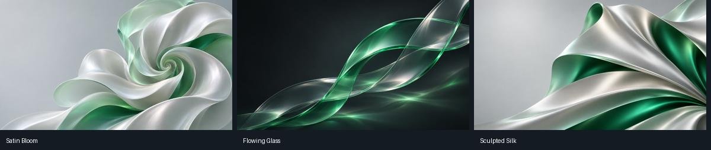](https://astrashadowsss.github.io/ShadowRealm-OS/#professional)

Professional pairs these three unbranded designs with Emerald, Ocean, Graphite or Plum accents.

## Shadow Games for Android

Play nine offline games with touch controls on Android. [Download the APK](https://github.com/AstraShadowsss/ShadowRealm-OS/releases/tag/shadow-games-android-v1.0.1) or see the [installation guide and screenshots](docs/shadow-games-android.md).

## Beta status

This is an early public release. Installation and desktop checks are documented in [release validation](docs/validation.md). Physical hardware coverage is limited; test your graphics, sound, wireless and suspend behavior from the live desktop. Secure Boot and dual-boot installations are not certified for this beta. Keep a backup and recovery media.

See the [project roadmap](docs/roadmap.md) for the Control Center redesign, desktop customization, and optional tools. If the Processes card stays empty, the [widget guide](docs/widgets.md#if-the-processes-card-stays-empty) explains what to include in a report.

Debian and configured vendor repositories provide their package updates. The revised Beta 1 image also includes the signed ShadowRealm-OS repository for custom desktop components and games. Refresh Software & Updates to see available APT updates; installing them remains your choice. Flatpak applications update separately. See [repository details and setup for the earlier image](docs/update-repository.md).

## Source and licenses

Original project work is supplied under the [MIT license](LICENSE). Linux, Debian packages, the modified Xfce panel, libraries, firmware, fonts and adapted icons retain their own licenses; they are not relicensed as MIT. See [third-party licensing and source availability](THIRD_PARTY_LICENSES.md).

This repository contains the custom source, configurations, artwork masters and build recipes. The ISO and matching third-party source distribution belong on SourceForge, outside Git history. Personal files and VM disks are not part of this repository.

[Report a bug](https://github.com/AstraShadowsss/ShadowRealm-OS/issues) | [SourceForge](https://sourceforge.net/projects/shadowrealm-os/)

Created and maintained by AstraShadows
