# ShadowRealm-OS

A Debian 13 desktop with its own look, built around Xfce and a set of small, integrated desktop tools.

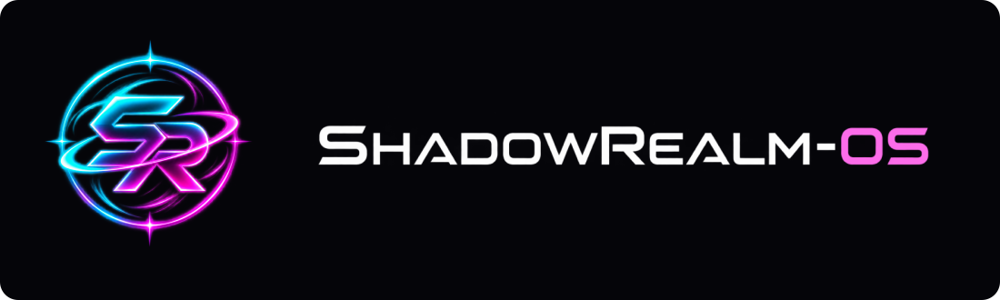

**2026.11 beta 1 · AMD64 · live desktop and installer**

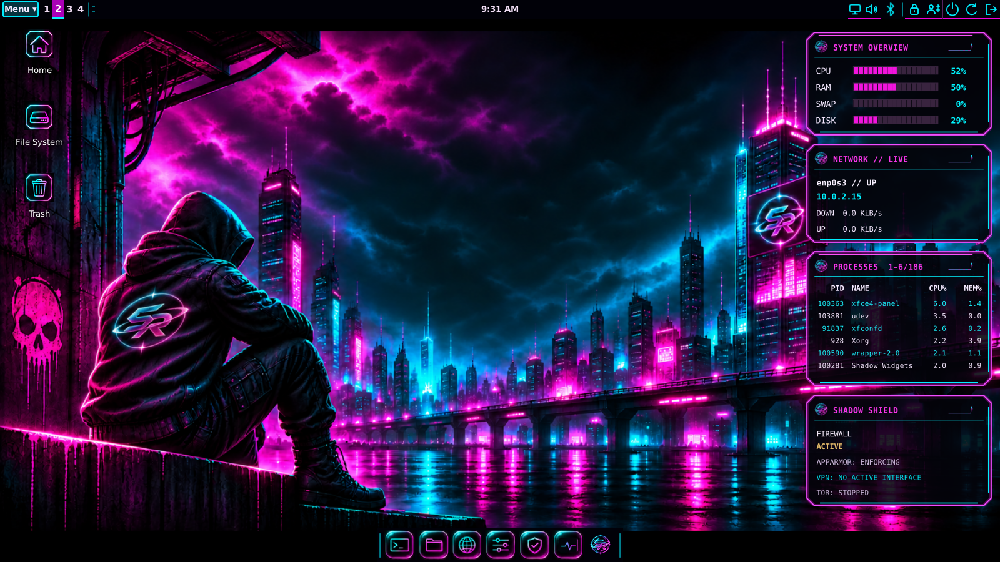

ShadowRealm-OS keeps the familiar Linux desktop: applications, files, a terminal and a package manager. Its custom panel, dock, widgets and Control Center bring the everyday controls together. Eight coordinated styles range from Neon and Hacker to White, Silver & Gold and a quieter Professional theme. Wallpapers can be changed separately.

## Download and install

[Download the beta ISO](https://sourceforge.net/projects/shadowrealm-os/files/2026.11-beta1/ShadowRealm-OS-2026.11-beta1-r4-amd64.iso/download) · [Checksums](https://sourceforge.net/projects/shadowrealm-os/files/2026.11-beta1/SHA256SUMS/download) · [Licenses & source-download guide](https://sourceforge.net/projects/shadowrealm-os/files/2026.11-beta1/)

The current installer retains the r3 correction for the installed-login failure in the withdrawn r2 image. Existing r2 installations can be [repaired without erasing files](docs/r2-install-recovery.md).

Check the ISO against `SHA256SUMS` before writing it to a USB drive or attaching it to a virtual machine.

The AMD64 ISO starts a live desktop so you can try it before installing. Open **Install ShadowRealm-OS** to install to a disk. The installer supports BIOS and UEFI systems and offers disk encryption. Back up your files first; choosing to erase a disk deletes its contents.

- [Install on a PC or in VirtualBox](docs/installation.md)
- [System requirements and test limits](docs/system-requirements.md)
- [Desktop, software and updates](docs/user-guide.md)
- [Build from source](docs/build-guide.md)

## Included

- Custom application menu with categories, favorites and adjustable sizing; editable dock and desktop shortcuts.
- Coordinated GTK, window, icon, terminal, login and boot artwork using the SR identity.
- Control Center for appearance, accounts, network, audio, Bluetooth and system tools. Hardware controls depend on the available device and driver.
- Debian APT packages, signed LibreWolf and Jami repositories, and Flatpak support.
- LibreWolf, Thunderbird, LibreOffice, VLC, Thunar, Mousepad and other desktop applications. See the release package inventory for exact versions.
- Shadow Shield controls for the firewall and privacy tools, plus AppArmor policies. These tools do not make a system anonymous or immune to attacks.
- Drawing for simple painting; GNOME Clocks for alarms, timers, world clocks and stopwatch.
- Customizable login backgrounds, optional original session chimes and three screensaver animations with standard XFCE locking.
- Nine offline games, including Shadow Pinball, Skull Invaders, Shadow Runner, Circuit Chase, Snake, Shadow Spider Solitaire, Neon Ascent, Neon Breaker and Marble Reactor. Scores and settings stay local.

## Screenshots

Desktop captures from ShadowRealm-OS, with gameplay and theme galleries below.

### Seated City themes

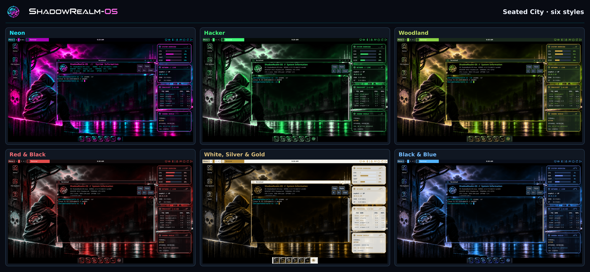

### Professional

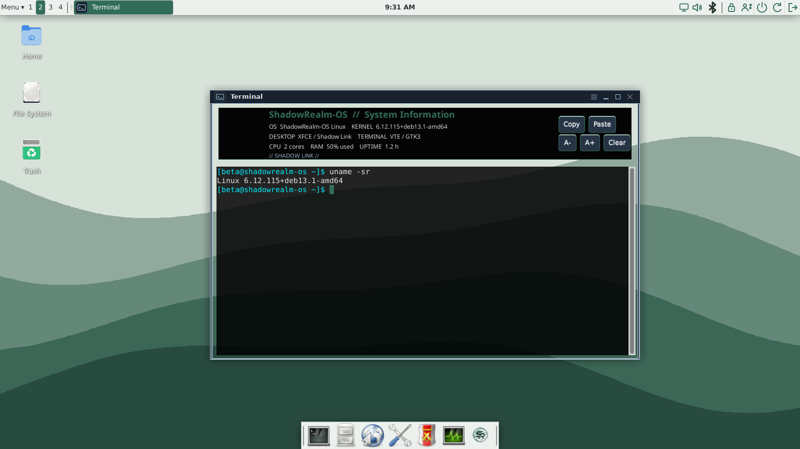

### Games

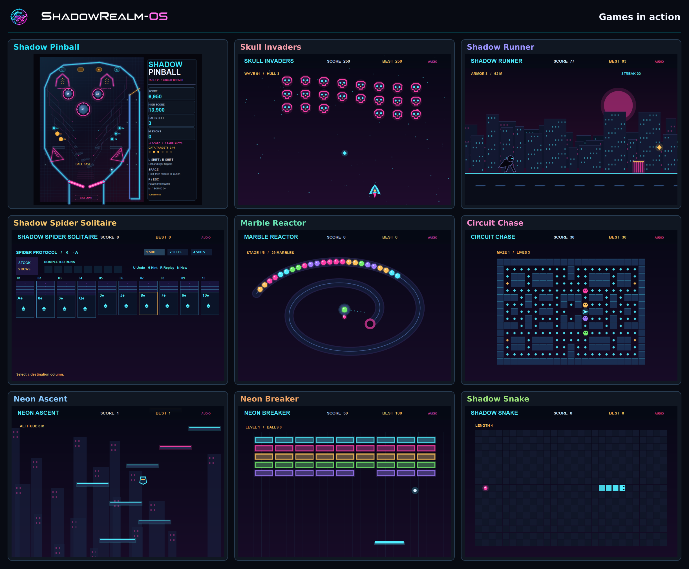

### Applications and settings

| Application menu | Control Center |
| --- | --- |
| 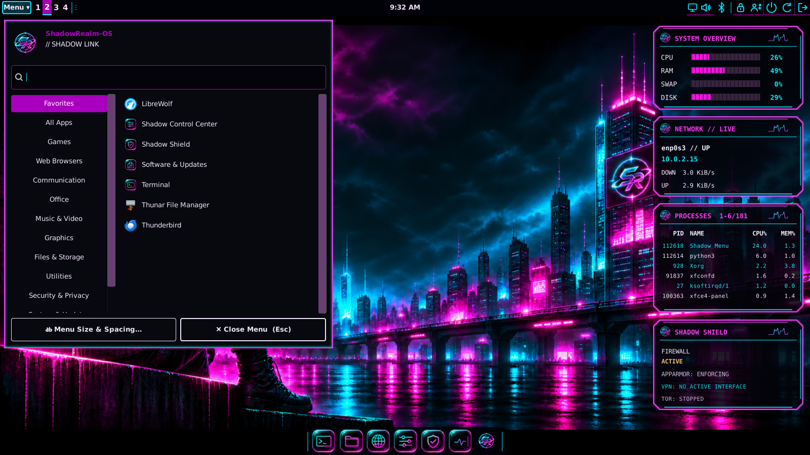 | 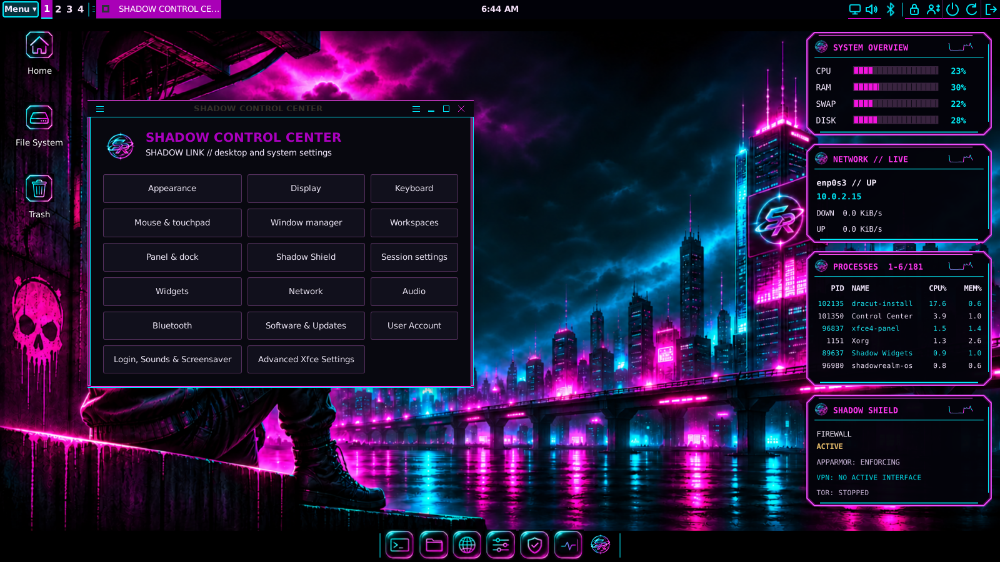 |

### Live desktop panels

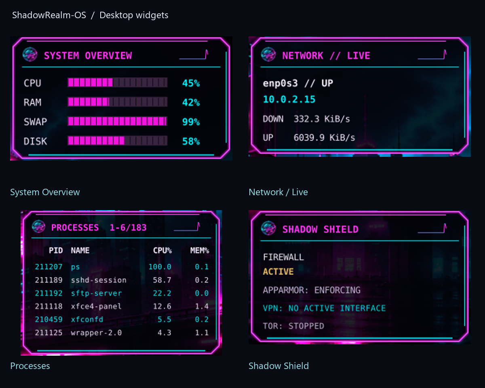

System Overview shows resource use; Network shows interface traffic; Processes lists running programs; Shadow Shield summarizes firewall and privacy service status. [What each reading means](docs/widgets.md). The source is included so these local tools can be inspected and maintained.

### Network, security and updates

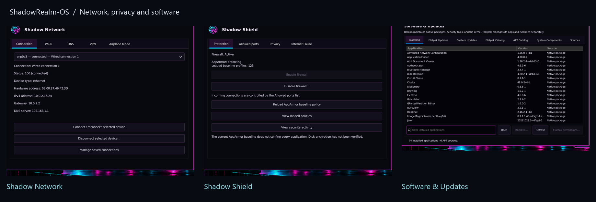

### Wallpaper collection

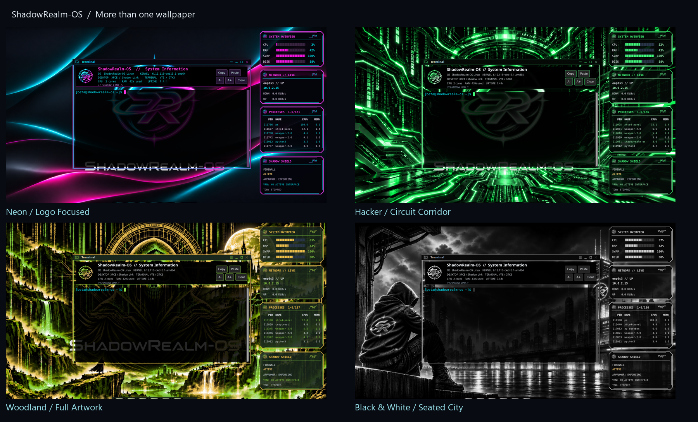

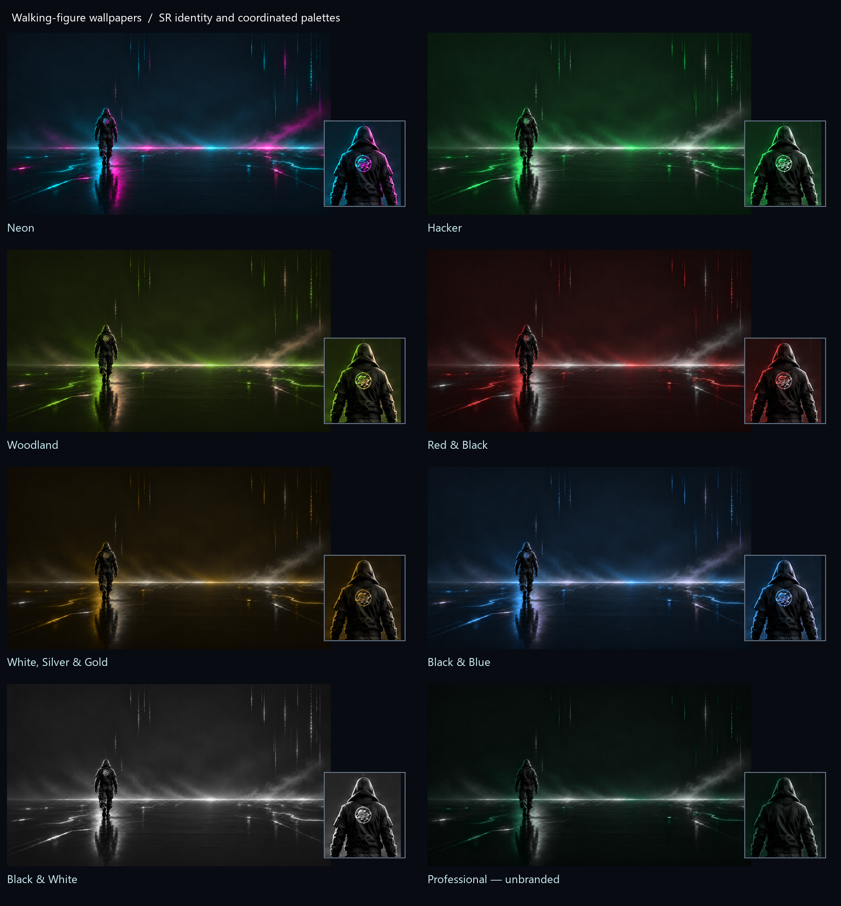

## Beta status

This is an early public release. Installation and desktop checks are documented in [release validation](docs/validation.md). Physical hardware coverage is limited; test your graphics, sound, wireless and suspend behavior from the live desktop. Secure Boot and dual-boot installations are not certified for this beta. Keep a backup and recovery media.

Debian and configured vendor repositories provide their package updates. The revised Beta 1 image also includes the signed ShadowRealm-OS repository for custom desktop components and games. Refresh Software & Updates to see available APT updates; installing them remains your choice. Flatpak applications update separately. See [repository details and setup for the earlier image](docs/update-repository.md).

## Source and licenses

Original project work is supplied under the [MIT license](LICENSE). Linux, Debian packages, the modified Xfce panel, libraries, firmware, fonts and adapted icons retain their own licenses; they are not relicensed as MIT. See [third-party licensing and source availability](THIRD_PARTY_LICENSES.md).

This repository contains the custom source, configurations, artwork masters and build recipes. The ISO and matching third-party source distribution belong on SourceForge, outside Git history. Personal files and VM disks are not part of this repository.

[Report a bug](https://github.com/AstraShadowsss/ShadowRealm-OS/issues) · [SourceForge](https://sourceforge.net/projects/shadowrealm-os/)

Created and maintained by AstraShadows
