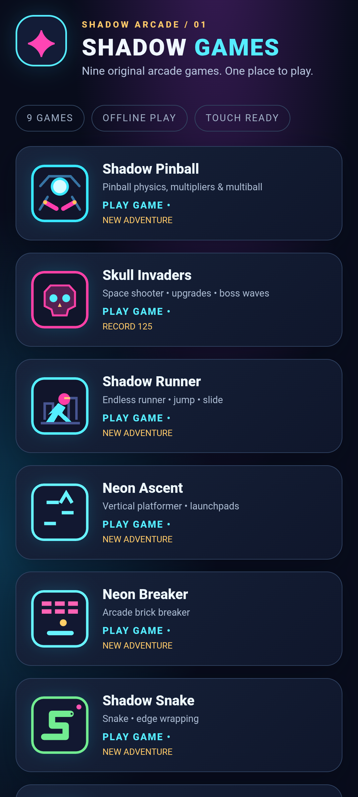
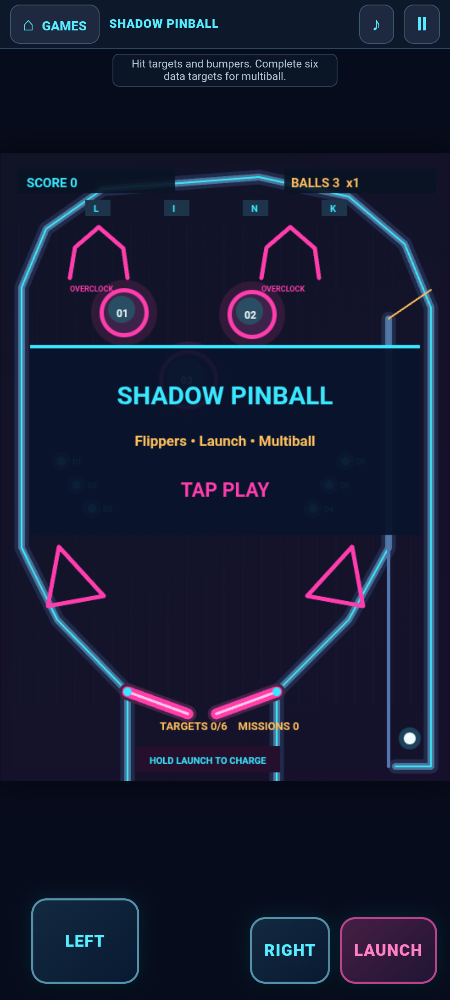
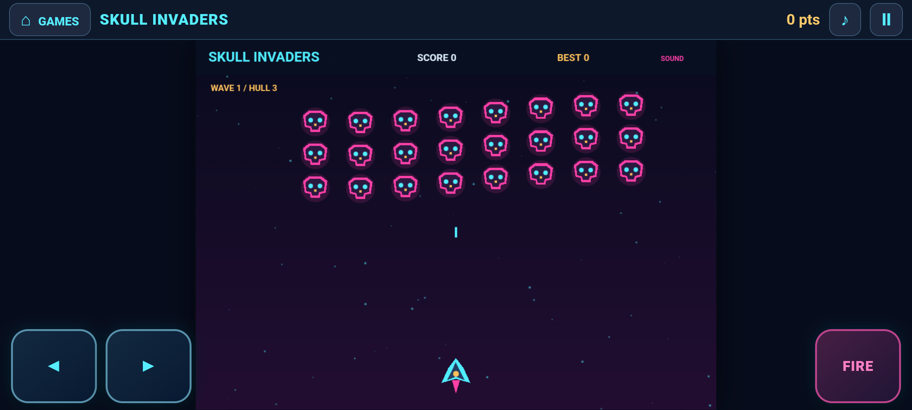

# Shadow Games for Android

Shadow Games brings nine offline games from ShadowRealm-OS to Android with touch controls and local high scores. The preview requires Android 7.0 or later. Pinball plays in portrait, and the other games play in landscape.

## Screenshots

Captured from the installed APK in the Android emulator.

| Games menu | Shadow Pinball |
| --- | --- |
|  |  |

## Install on your phone

1. Download **ShadowGames-Android.apk** from the [Android release page](https://github.com/AstraShadowsss/ShadowRealm-OS/releases/tag/shadow-games-android-v1.0.0).
2. Open the APK from Downloads or your file manager. If Android asks, open Settings and enable **Allow from this source** for the app opening the file.
3. Return to the installer, tap **Install**, and open **Shadow Games**. You can turn off **Allow from this source** after installing.

Developer options and a USB cable are unnecessary for a normal on-phone install. Some devices or managed profiles apply extra rules to APK installation. Leave Play Protect enabled and only use a download you trust. [Google's installation guide](https://support.google.com/pixelphone/answer/7391672)

## Install over USB with ADB

1. Install [Android SDK Platform Tools](https://developer.android.com/tools/releases/platform-tools) on your computer.
2. On your phone, find **Settings → About phone → Build number** and tap **Build number** seven times. On some phones it is under **Software information**.
3. Open **Developer options** and enable **USB debugging**. Connect the phone, unlock it, and approve the debugging prompt for your computer.
4. Run `adb devices` to confirm the connection. From the download directory, run `adb install ShadowGames-Android.apk`. Open **Shadow Games** on your phone and turn off USB debugging when finished.

See [Android's USB debugging guide](https://developer.android.com/studio/debug/dev-options) and [ADB install documentation](https://developer.android.com/tools/adb#move).

## Build details

- App ID: `com.shadowgames.mobile`
- Version: 1.0.0
- Distribution: debug-signed preview for sideloading. An existing installation signed with a different key may need to be removed first. Uninstalling erases its local scores and settings.
- APK SHA-256: `60c7584de41f1fa766bc38bb3bde4f12eae94c098a37150a81db13519bdd8c7c`

The [game license](shadow-games-android-license.txt) accompanies this download.
