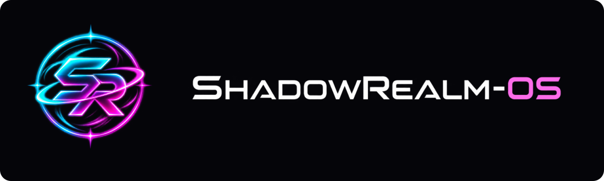
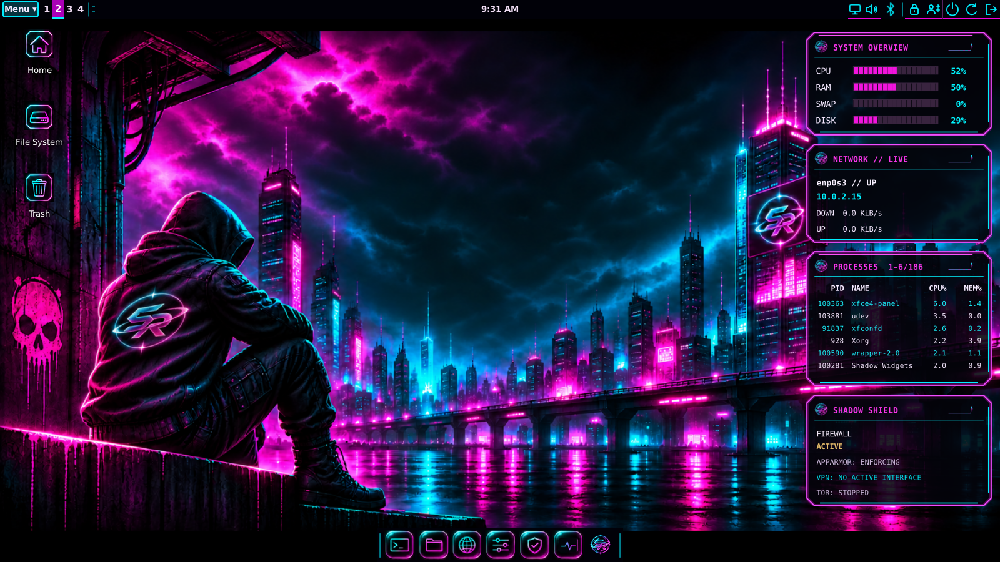

# ShadowRealm-OS

A Debian 13 and Xfce desktop with coordinated themes, integrated controls and a live AMD64 installer. **2026.11 beta 1.**

[Download the ISO](https://sourceforge.net/projects/shadowrealm-os/files/2026.11-beta1/ShadowRealm-OS-2026.11-beta1-r2-amd64.iso/download) · [Checksums & licenses](https://sourceforge.net/projects/shadowrealm-os/files/2026.11-beta1/) · [Custom source & source-download guide](https://sourceforge.net/projects/shadowrealm-os/files/2026.11-beta1/Sources/) · [Third-party sources (GitHub)](https://github.com/AstraShadowsss/ShadowRealm-OS/releases/tag/2026.11-beta1-r2) · [Project website](https://shadowrealm-os.sourceforge.io/) · [Source and documentation](https://github.com/AstraShadowsss/ShadowRealm-OS)

- Eight coordinated styles, independent wallpapers and an editable dock.
- Four local desktop panels for resources, interface traffic, processes and security-service status.
- Appearance, accounts, network, audio, Bluetooth and software controls.
- Signed custom component/game updates alongside Debian and configured vendor repositories.
- Everyday desktop applications and nine offline games.
- Graphical installation with optional disk encryption.

Read the installation and validation guides before changing disks. This is a public beta: hardware coverage is limited, and Secure Boot, shared-ESP dual boot and suspend/resume are not certified. Original project work is MIT; bundled third-party software retains its own licenses. Matching notices and corresponding source accompany the release.

[Updates & Packages](https://shadowrealm-os.sourceforge.io/apt/) - browse the signed component and game packages.

## Try or install

Verify the ISO against SHA256SUMS before writing a USB drive or attaching it in VirtualBox. Boot the ISO to try the live desktop; open Install ShadowRealm-OS to install. Back up your files before changing disk partitions. The live account is user, password live. Installed users choose their own account password and, if enabled, a separate disk-encryption passphrase.

- [Installation and VirtualBox setup](https://github.com/AstraShadowsss/ShadowRealm-OS/blob/main/docs/installation.md)
- [System requirements and known limits](https://github.com/AstraShadowsss/ShadowRealm-OS/blob/main/docs/system-requirements.md)
- [Desktop guide](https://github.com/AstraShadowsss/ShadowRealm-OS/blob/main/docs/user-guide.md)
- [Matching source downloads and instructions](https://sourceforge.net/projects/shadowrealm-os/files/2026.11-beta1/Sources/)

